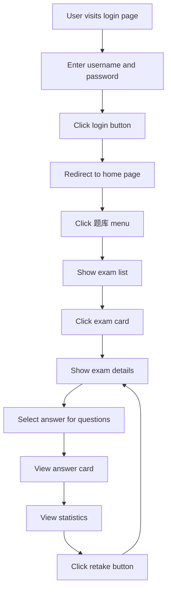

## 1. Product Overview
在线考试系统前端项目，为用户提供题库浏览和答题功能。用户可登录系统查看题库列表，进入题库详情进行答题，系统提供答题卡和答题统计功能。

## 2. Core Features

### 2.1 User Roles
| Role | Registration Method | Core Permissions |
|------|---------------------|------------------|
| User | Login with username/password | Browse exam lists, take exams, view results |

### 2.2 Feature Module
1. **Login page**: User authentication with username and password
2. **Home page**: System header, navigation menu, content area
3. **Exam list page**: Display exam cards with basic info
4. **Exam details page**: Question display, answer selection, navigation, answer card, statistics

### 2.3 Page Details
| Page Name | Module Name | Feature description |
|-----------|-------------|---------------------|
| Login | Login form | Username input, password input, login button |
| Home | Header | Display system name and current username |
| Home | Sidebar menu | Display menu items (题库) |
| Home | Content area | Render selected page content |
| Exam List | Card list | Show exam cards with title, description, question count |
| Exam Details | Question area | Display question stem, options, navigation buttons |
| Exam Details | Answer card | Show all question numbers with status colors |
| Exam Details | Statistics | Show correct/wrong/unanswered counts, accuracy rate, retake button |

## 3. Core Process

## 4. User Interface Design

### 4.1 Design Style
- Primary color: #3B82F6 (blue)
- Secondary color: #10B981 (green for correct), #EF4444 (red for wrong)
- Button style: Rounded corners (8px), gradient hover effects
- Font: Inter, system fonts
- Layout: Card-based design, clean and modern
- Icons: Lucide React

### 4.2 Page Design Overview

#### Login Page
- Centered login form with card-style container
- Username and password inputs with icons
- Login button with gradient background
- Responsive layout for all devices

#### Home Page
- Header: System name on left, username on right
- Sidebar: Fixed width menu with active state
- Content area: Flexible width for main content

#### Exam List Page
- Grid layout of exam cards
- Cards with title, description, question count, thumbnail
- Hover effects on cards

#### Exam Details Page
- Question area: Stem on left, answer card on right
- Options: Radio buttons for selection
- Navigation: Previous/Next buttons
- Answer card: Grid of question numbers with color coding
- Statistics: Summary bar with counts and accuracy

### 4.3 Responsiveness
- Desktop (>1024px): Full layout with sidebar
- Tablet (768px-1024px): Collapsible sidebar, compact layout
- Mobile (<768px): Stacked layout, hamburger menu, answer card below questions

### 4.4 Color Scheme
| Color | Usage |
|-------|-------|
| #3B82F6 | Primary color, buttons, links |
| #10B981 | Correct answers, success states |
| #EF4444 | Wrong answers, error states |
| #FFFFFF | Unanswered, default state |
| #F3F4F6 | Background, card borders |
| #1F2937 | Text, dark mode |