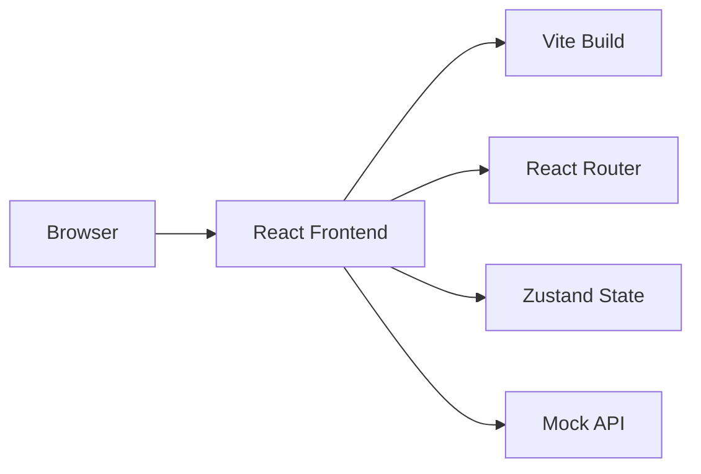
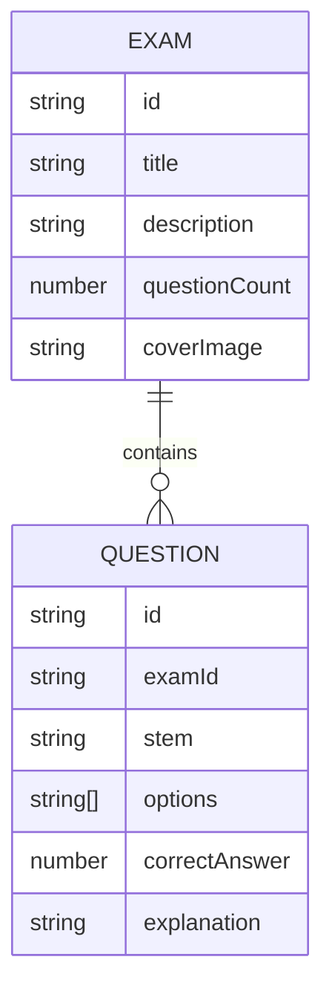

## 1. Architecture Design


## 2. Technology Description
- Frontend: React@18 + TypeScript + TailwindCSS@3
- Initialization Tool: vite-init
- Backend: None (Mock data only)
- State Management: Zustand
- Routing: React Router DOM
- Icons: Lucide React

## 3. Route Definitions
| Route | Purpose | Component |
|-------|---------|-----------|
| /login | User login | LoginPage |
| /home | Home page with sidebar | HomePage |
| /home/exam-list | Exam list | ExamListPage |
| /home/exam-detail/:id | Exam details | ExamDetailPage |

## 4. API Definitions (Mock)

### 4.1 Login
**POST** `/api/login`
- Request: `{ username: string, password: string }`
- Response: `{ success: boolean, token: string, user: { username: string } }`

### 4.2 Exam List
**GET** `/api/exams`
- Response: `{ exams: Exam[] }`

### 4.3 Exam Details
**GET** `/api/exams/:id`
- Response: `{ exam: Exam, questions: Question[] }`

## 5. Data Model

### 5.1 Data Model Definition


### 5.2 TypeScript Types
```typescript
interface Exam {
  id: string;
  title: string;
  description: string;
  questionCount: number;
  coverImage: string;
}

interface Question {
  id: string;
  examId: string;
  stem: string;
  options: string[];
  correctAnswer: number;
  explanation: string;
}

interface UserAnswer {
  questionId: string;
  selectedOption: number;
  isCorrect: boolean;
}

interface ExamState {
  currentExam: Exam | null;
  questions: Question[];
  currentQuestionIndex: number;
  userAnswers: UserAnswer[];
  isCompleted: boolean;
}
```

## 6. Project Structure
```
src/
├── components/
│   ├── Header.tsx
│   ├── Sidebar.tsx
│   ├── ExamCard.tsx
│   ├── Question.tsx
│   ├── AnswerCard.tsx
│   └── Statistics.tsx
├── pages/
│   ├── LoginPage.tsx
│   ├── HomePage.tsx
│   ├── ExamListPage.tsx
│   └── ExamDetailPage.tsx
├── store/
│   └── examStore.ts
├── mock/
│   └── data.ts
├── types/
│   └── index.ts
├── App.tsx
├── main.tsx
└── index.css
```

## 7. Responsive Design Strategy
- Use TailwindCSS breakpoints: sm (640px), md (768px), lg (1024px), xl (1280px)
- Desktop: Full sidebar visible, answer card on right
- Tablet: Sidebar collapsible, answer card below questions on mobile
- Mobile: Hamburger menu for sidebar, stacked layout, touch-friendly buttons